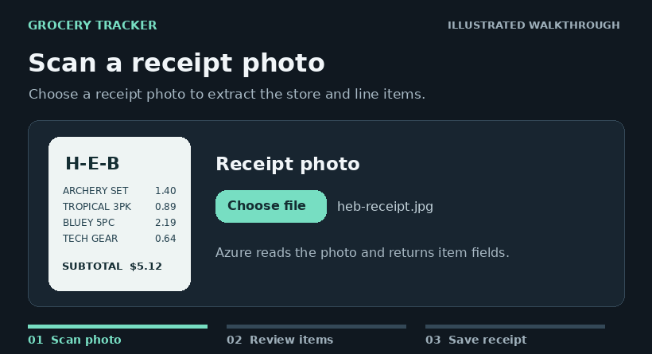

# CartTrail

Turn a receipt photo into an editable list of purchases. Review the scanned items against the printed subtotal, then save the receipt to your account and track monthly spending.

[Open the live app](https://grocery-tracker.hinkel-nicholas12.workers.dev/) · Sign-in requires an existing account.

## Demo



The animation walks through the workflow with sample data: a scan misreads one price, the subtotal check flags a $0.50 difference, and fixing the line clears it before the receipt is saved.

## Videos

- [Full walkthrough with voiceover](docs/carttrail-promo.mp4) (51 seconds, 16:9)
- [15-second social cut](docs/carttrail-social-15s.mp4) (vertical 9:16, with voiceover and music)

Both were recorded from the app with sample data and a mocked backend.

## How it works

1. Upload a JPEG or PNG receipt. A Supabase Edge Function verifies your session and sends the image to Azure Document Intelligence.
2. Review the extracted store, date, quantities, and prices. The form compares the entered line totals with the scanned subtotal when available.
3. Save the reviewed receipt and its items to PostgreSQL in one transaction. Supabase row-level security limits access to the receipt owner.

The frontend uses React and Vite and is hosted on Cloudflare Workers. Monthly spending sums saved line amounts and displays them in USD. Review the scan against the original receipt before saving.

## Run locally

```bash
npm ci
npm run dev
```

Create `.env.local` in the project root with your Supabase project URL and publishable key.

```dotenv
VITE_SUPABASE_URL=https://your-project-ref.supabase.co
VITE_SUPABASE_PUBLISHABLE_KEY=your-publishable-key
```

For your own backend, configure Supabase Auth, the `receipts` and `receipt_items` tables with ownership policies, and the `save_grocery_receipt` database function. Create a test user in Supabase and deploy the [`hyper-handler` Edge Function](supabase/functions/hyper-handler/index.ts). Set `AZURE_DOCUMENT_ENDPOINT` and `AZURE_DOCUMENT_KEY` in Supabase Edge Function secrets.

## Trends and store locations

Trends charts show monthly spending, product prices per recorded unit, and category spending. Period and store filters apply to the charts, rankings, and map. The figures come from saved receipt lines in USD.

Apply the [receipt locations migration](supabase/migrations/20261105010000_receipt_locations.sql) in Supabase to enable the spending map. Choose a saved receipt and pin its store branch manually. Branches with the same saved coordinates are grouped. Opening the map loads the OpenStreetMap basemap through Leaflet.

## Suggested receipt branches

Apply [saved store branches](supabase/migrations/20261105020000_saved_store_branches.sql) after the earlier category and location migrations, and redeploy [hyper-handler](supabase/functions/hyper-handler/index.ts). The scan returns Azure's merchant address. A previously confirmed branch is reused; unfamiliar U.S. addresses are looked up through the U.S. Census Geocoder and require confirmation before being saved as a branch.

The Census lookup needs no API key and returns approximate coordinates. Choosing a saved branch or skipping location remains available when an address is missing, outside the U.S., ambiguous, or unavailable. New address lookups send the merchant address to Census. Store branches and links are private to each account.

To enable store-name search, add a Geoapify key as `GEOAPIFY_API_KEY` in Supabase Edge Function secrets and deploy the updated `hyper-handler`. Search accepts a store name plus a city, street, or ZIP code. Select the correct result before saving. Search sends the query text to Geoapify.
